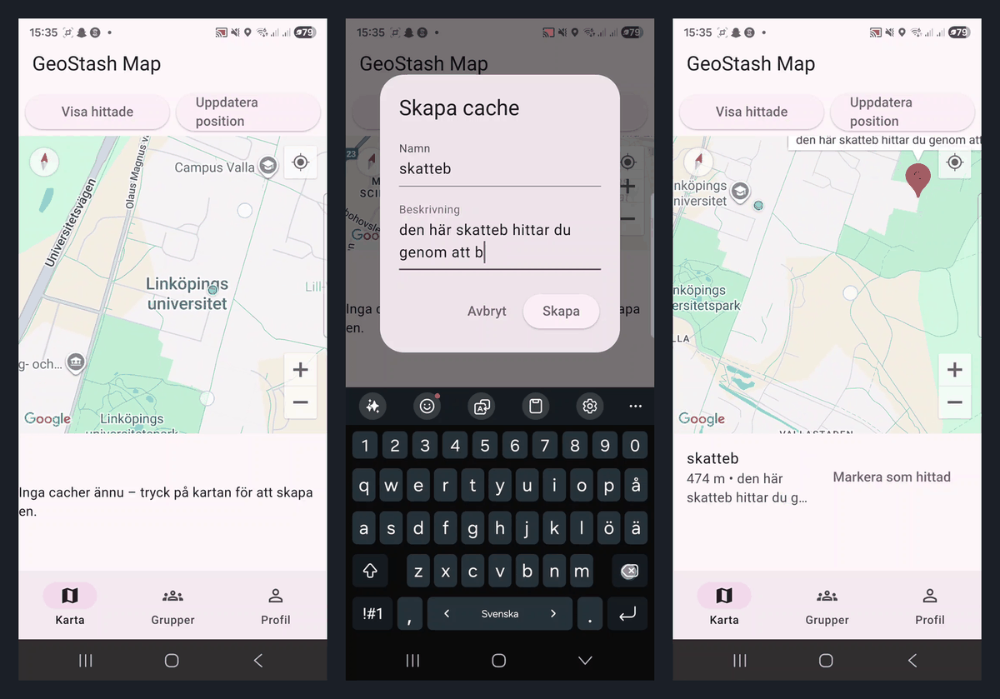
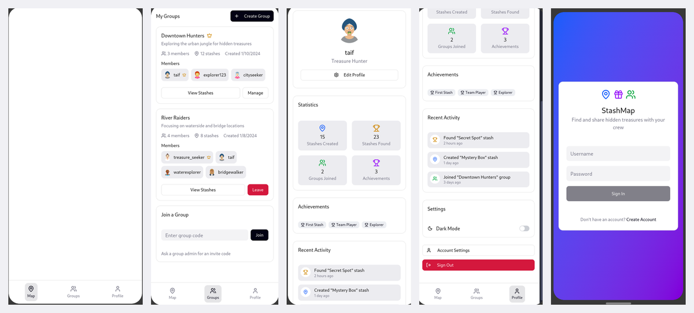

# GeoStash

GeoStash is a mobile app for a digital treasure hunt. Friends form groups, place hiding spots on a map and go find each other's spots. I built it on my own in Flutter.



## What it does

- Sign in with email and password or with Google (Firebase Authentication)
- Create a group, or join one with a randomly generated code
- Place hiding spots on a Google Maps map and see the distance to them from your GPS position (Haversine formula)
- Data syncs in real time through Firestore snapshots
- Profile with created and found spots, light and dark theme, Swedish and English

Before writing code I did a competitor analysis and wireframes (Figma). The distance calculation and the group codes have unit tests.



## Tech stack

Flutter, Dart, Provider, Firebase Authentication, Cloud Firestore, Google Maps, Geolocator.

## Running it

The app code is in `myapp/`. Firebase config and API keys are not in the repo, so you need your own Firebase project.

1. Create a Firebase project with Authentication (Email/Password and Google) and Firestore enabled.
2. In `myapp/`, run `flutterfire configure`. That generates `lib/firebase_options.dart` and `android/app/google-services.json` (both are git-ignored). `lib/firebase_options.dart.example` shows the expected shape.
3. Put a Google Maps API key and your OAuth web client id in `android/app/src/main/res/values/strings.xml` (`YOUR_GOOGLE_MAPS_API_KEY`, `YOUR_WEB_CLIENT_ID`). Don't commit the real values.
4. Run:

```bash
cd myapp
flutter pub get
flutter run
flutter test
```

## Docs

`docs/course/` has the planning documents from the course in Swedish: the project description, the competitor analysis, the weekly plan and the technical memo.

Built as a course project at Linköping University (TDP028).

More of my projects: https://tdp003-2024-taiku983.kubernetes-public.it.liu.se/
